<div align="center">


# Suíte Orla

**Case de UX/UI e front-end: três sistemas de gestão de rede de uma operadora de saúde, construídos sobre um design system compartilhado.**


[Ver a suíte](https://fernandopinhel.github.io/redeMais/) ·
[Orla Mesa](https://fernandopinhel.github.io/redeMais/novo-painel-sgta/) ·
[Orla Esteira](https://fernandopinhel.github.io/redeMais/novo-controle-aditamento/) ·
[Orla Placar](https://fernandopinhel.github.io/redeMais/controle-aditamento/) ·
[Orla DS](https://fernandopinhel.github.io/redeMais/ds/)

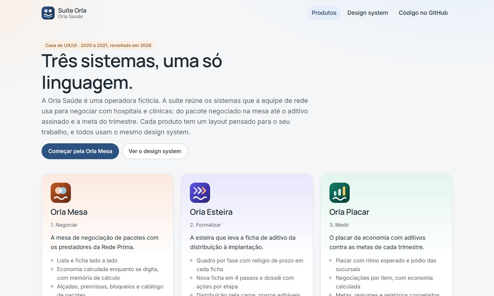

</div>

> **Este é um case de portfólio.** Os três sistemas nasceram entre 2020 e 2021, numa empresa onde
> trabalhei, para a equipe de rede de uma operadora de saúde. Aqui eles foram recriados para mostrar
> o processo e o resultado. Para preservar a empresa e o cliente, a interface usa a operadora fictícia
> **Orla Saúde**. Prestadores, pessoas, CNPJs, códigos de pacote e valores são todos de exemplo, e
> nada do que você digita sai do seu navegador.

---

## Sumário

- [O case](#o-case)
- [Os três produtos](#os-três-produtos)
  - [Orla Mesa](#orla-mesa-negociar)
  - [Orla Esteira](#orla-esteira-formalizar)
  - [Orla Placar](#orla-placar-medir)
- [O design system](#o-design-system)
- [Acessibilidade](#acessibilidade)
- [Tecnologias e arquitetura](#tecnologias-e-arquitetura)
- [Como rodar localmente](#como-rodar-localmente)
- [Publicação no GitHub Pages](#publicação-no-github-pages)
- [Segurança e privacidade](#segurança-e-privacidade)
- [Limitações e próximos passos](#limitações-e-próximos-passos)
- [Histórico](#histórico)
- [Autor](#autor)

---

## O case

### Contexto

Uma operadora de saúde mantém contratos com centenas de hospitais e clínicas. Cada mudança de preço
ou de serviço vira um **aditivo** ao contrato, e cada aditivo começa numa negociação. Quando o projeto
começou, esse caminho passava por três sistemas que tinham crescido separados, todos com a mesma cara
de Bootstrap, e por muitas planilhas:

1. a equipe negociava **pacotes de procedimentos** com os prestadores mais estratégicos e calculava a economia numa planilha de premissas;
2. o acordo virava uma **ficha de aditivo**, que passava por distribuição, emissão, assinatura do prestador e implantação, sem que ninguém soubesse ao certo onde cada ficha estava parada;
3. no fim, a gestão comparava a **economia dos aditivos** com a meta de cada trimestre, também em planilha.

### O desafio da revisita

Os três protótipos originais usavam a mesma base visual, o que ajudava na manutenção, mas fazia os
produtos parecerem iguais e esconder o que cada um tinha de diferente. O objetivo agora foi:

- **um design system só**, com tokens, componentes e comportamentos acessíveis em comum;
- **uma identidade e um layout para cada produto**, desenhados a partir do trabalho que ele apoia;
- **fluxos funcionais de ponta a ponta**, com regras de negócio, e não só telas paradas.

### A marca fictícia

**Orla Saúde** é uma operadora inventada. O símbolo é uma onda, a orla, que aparece nos três produtos
e no DS. Em cima dela, cada produto ganha o seu desenho e a sua cor:

| Produto | Símbolo | Cor | Layout |
| --- | --- | --- | --- |
| Orla Mesa | Dois círculos que se cruzam: o acordo | Terracota | Abas no topo e mesa em duas colunas |
| Orla Esteira | Setas em sequência: o fluxo | Índigo | Trilho lateral e quadro por fase |
| Orla Placar | Barras subindo: a meta | Verde-petróleo | Navegação no topo e faixa do trimestre |

---

## Os três produtos

Os produtos seguem a ordem do trabalho: **negociar, formalizar e medir.** O acesso de demonstração
vale para a suíte inteira, e o ícone de produtos no topo leva de um para o outro sem novo login.

### Orla Mesa: negociar

*Pasta `novo-painel-sgta/`.* A mesa de negociação de pacotes com os prestadores da **Rede Prima**,
a rede preferencial da operadora.

| Mesa de negociação | Memória de cálculo |
| --- | --- |
| 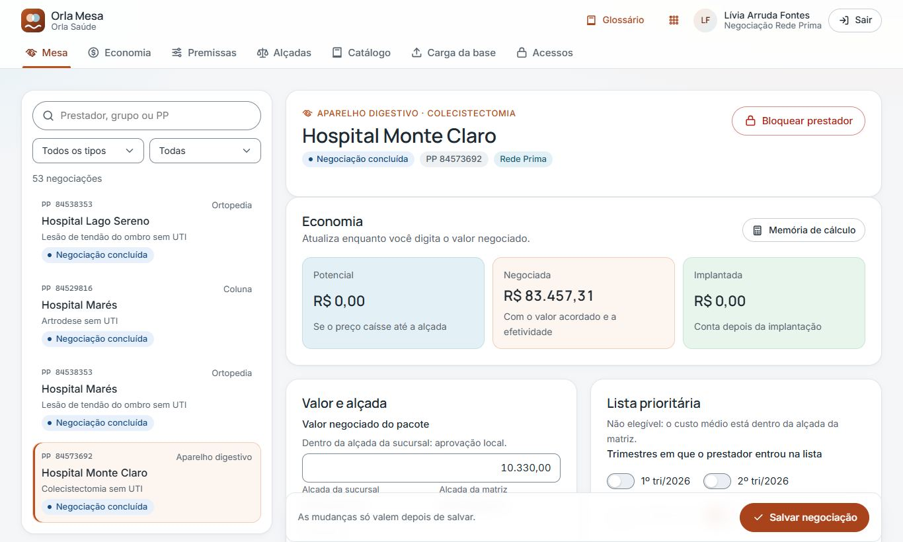 | 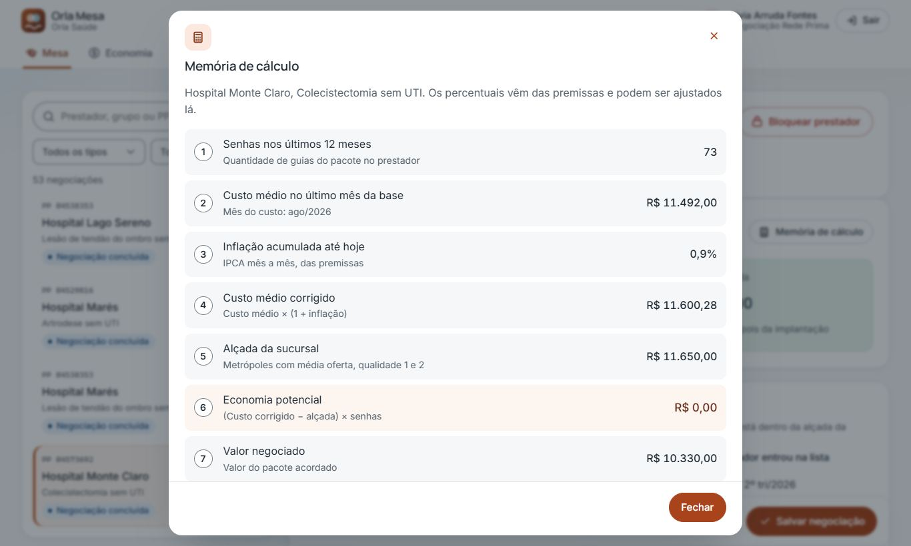 |

| Economia | Login |
| --- | --- |
| 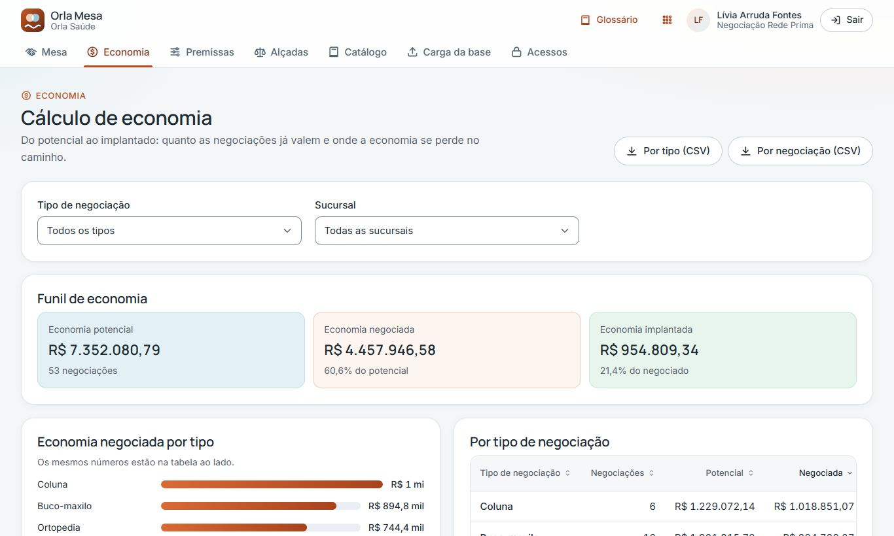 | 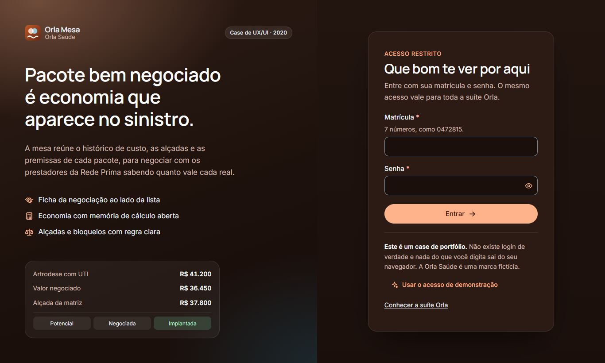 |

**Decisões de design**

- **Lista e ficha lado a lado.** Quem negocia passa por dezenas de prestadores por dia. Trocar de negociação sem perder a lista de vista corta cliques e contexto.
- **Economia ao vivo.** O funil (potencial, negociada e implantada) recalcula enquanto o valor é digitado, e a alçada em que o valor cai aparece logo abaixo do campo.
- **Memória de cálculo aberta.** A planilha de premissas virou um passo a passo de 11 linhas: senhas, custo médio, inflação, alçada, efetividade e captura. Ninguém precisa confiar num número sem saber de onde ele veio.
- **Glossário à mão.** PP, PPA, alçada, cluster e efetividade estão a um clique, no topo de todas as telas.

**O que funciona:** registrar valor e datas do aditivo (em ordem, sem datas futuras), aprovação da
diretoria quando o valor passa da alçada da matriz, bloqueio e desbloqueio do prestador com motivo,
premissas que mostram quanto a economia mudou ao salvar, inflação mês a mês, alçadas com validação de
faixa, catálogo de pacotes, de-para de PPA, não listados, carga da base e matriz de permissões por perfil.

### Orla Esteira: formalizar

*Pasta `novo-controle-aditamento/`.* A esteira que leva cada ficha de aditivo da distribuição à
implantação.

| Quadro por fase | Dossiê da ficha |
| --- | --- |
| 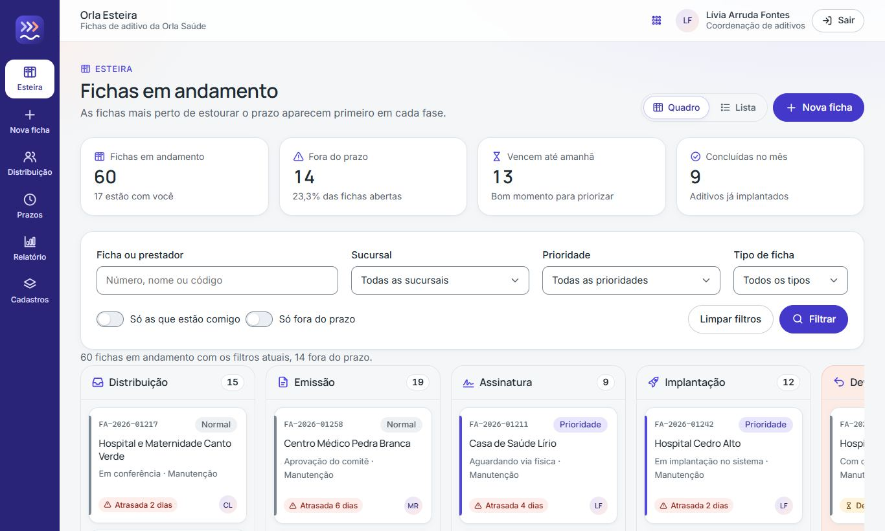 | 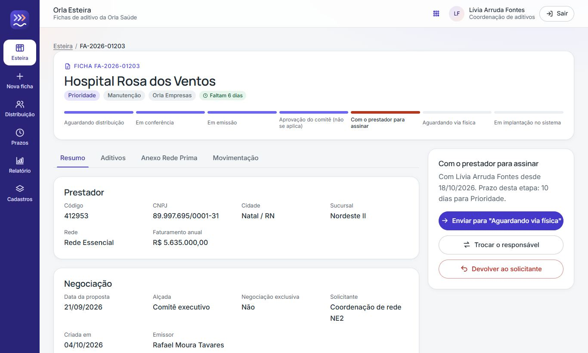 |

| Nova ficha com erros | Login |
| --- | --- |
| 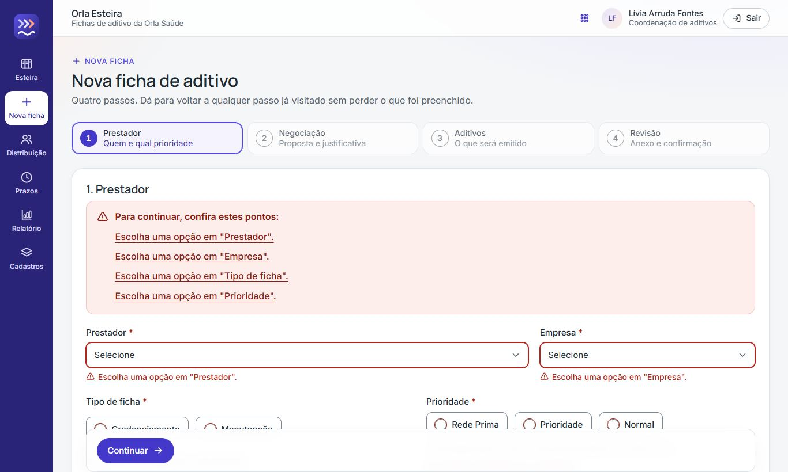 | 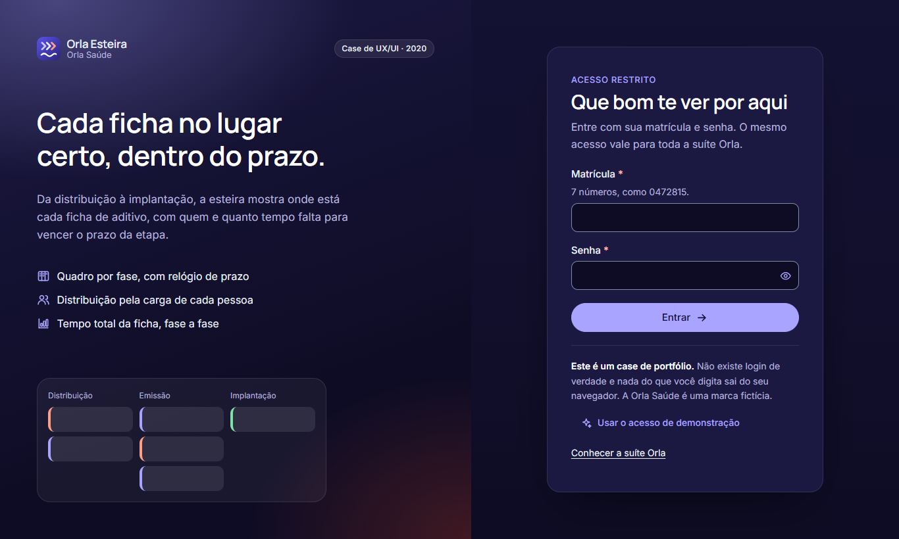 |

**Decisões de design**

- **O prazo é o protagonista.** O sistema original mostrava 17 status numa tabela de contagens. Agora eles cabem em 4 fases, e cada cartão tem um relógio: no prazo, vence hoje ou amanhã, atrasada. As mais perto de estourar aparecem primeiro.
- **Uma ação clara por etapa.** O dossiê mostra a etapa atual, com quem está e quanto tempo falta. O botão principal diz para onde a ficha vai ("Enviar para Em emissão"), e a sugestão de responsável é quem está com menos fichas.
- **Regra do comitê explicada.** Manutenção só com reajustes pula a aprovação do comitê, e a interface diz isso na hora de avançar.
- **Devolver não é perder.** A ficha devolvida para o relógio, guarda o motivo e volta para a mesma etapa quando a correção chega.

**O que funciona:** quadro e lista com filtros lembrados, nova ficha em 4 passos com validação por
passo (inclusive o anexo obrigatório da Rede Prima), avançar, devolver, retomar e trocar responsável
com histórico, distribuição em lote pela carga de cada pessoa, troca de emissor em lote, prazos
editáveis com prévia do impacto, relatório de tempo total por fase com exportação analítica e
sintética, e cinco cadastros de apoio com exclusão protegida.

### Orla Placar: medir

*Pasta `controle-aditamento/`.* O placar da economia com aditivos contra as metas de cada trimestre.

| Placar do trimestre | Negociação por item |
| --- | --- |
| 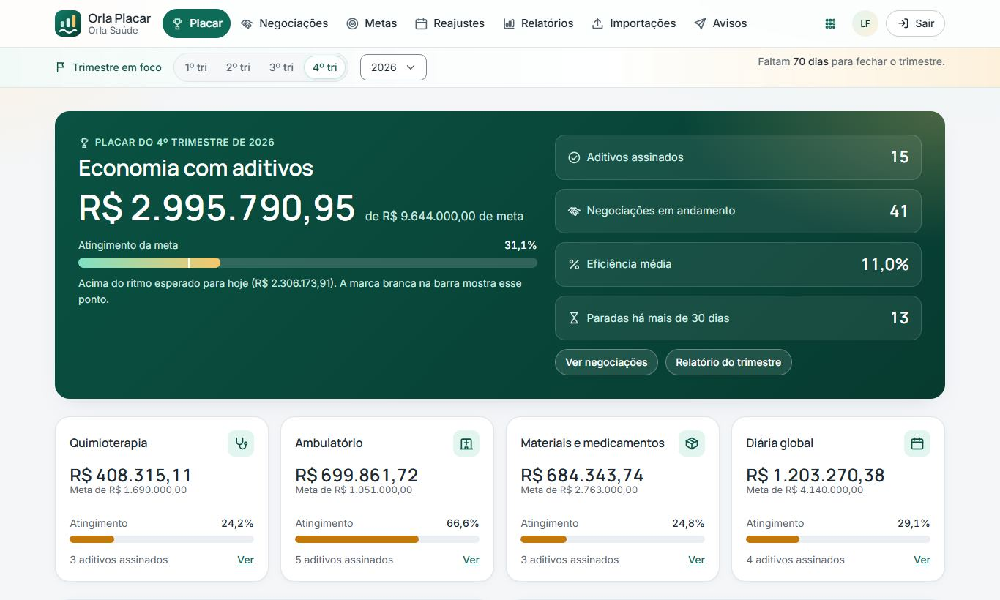 | 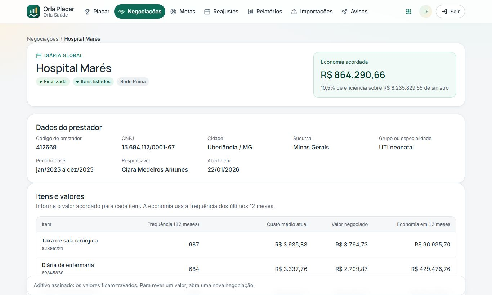 |

| Relatórios | Login |
| --- | --- |
| 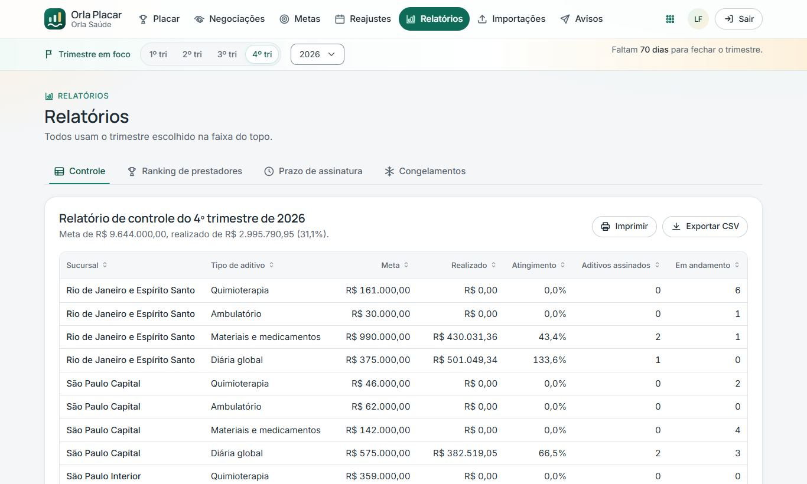 | 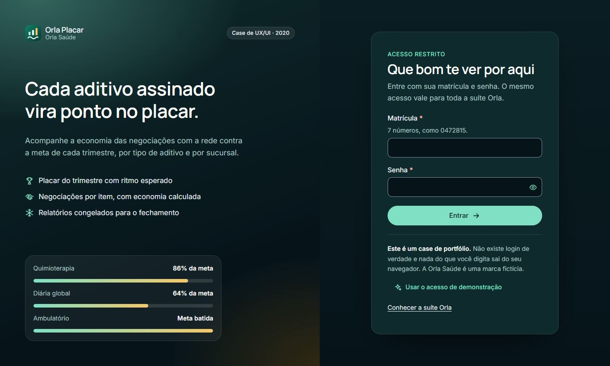 |

**Decisões de design**

- **O trimestre manda.** Uma faixa logo abaixo do menu escolhe o trimestre em foco, e ele vale para o placar, as metas e os relatórios. A faixa também diz quantos dias faltam para fechar.
- **Ritmo, não só total.** A barra da meta tem uma marca do ritmo esperado para o dia de hoje. Assim, 30% da meta no início do trimestre aparece como bom sinal, e não como atraso.
- **Economia por item.** O valor negociado é digitado item a item, e a economia de 12 meses aparece na linha e no total enquanto se digita.
- **Fechamento confiável.** Um trimestre pode ser congelado. A versão congelada não muda mais, e a comparação mostra o que mudou desde então.

**O que funciona:** troca de trimestre em todas as telas, nova negociação a partir da base de sinistro,
registro do acordo e da assinatura com validações de valor e data, encerramento sem acordo e reabertura,
metas com cópia do trimestre anterior e reajuste, datas de reajuste dos prestadores com alteração em
lote e dois relatórios para exportar, ranking de prestadores, prazo de assinatura por sucursal,
importação de planilha com inconsistências e avisos por e-mail.

---

## O design system

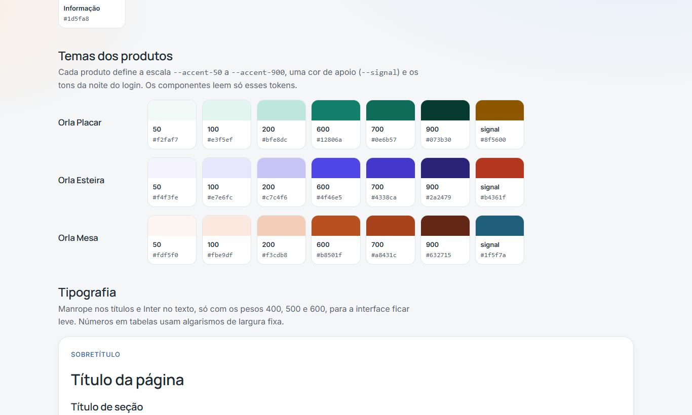

O **Orla DS** fica em [`ds/`](ds/) e tem uma [página própria](https://fernandopinhel.github.io/redeMais/ds/)
com tokens, temas e componentes ao vivo.

- **Tokens** de cor, tipografia, forma, espaço e sombra em `ds.css`. Os componentes leem só os papéis (`--primary`, `--accent-100`, `--signal`), nunca uma cor fixa.
- **Tema por produto em 15 linhas.** Cada `css/app.css` começa redefinindo a escala `--accent-50` a `--accent-900`, a cor de apoio e os tons do login. O resto do arquivo é só o layout próprio.
- **Componentes:** botões, campos, grupos de escolha, interruptores, avisos, selos, indicadores, medidores, barras, abas, etapas, linha do tempo, tabela, paginação, diálogo, toast, menu suspenso e login escuro.
- **Comportamento em `ds.js`:** validação com resumo de erros, máscaras, tabela com ordenação e seleção, diálogos nativos, abas com teclado, exportação para CSV, sessão compartilhada, alternador de produtos e um **CRUD guiado por esquema**: os 15 cadastros de apoio da suíte são descritos em poucas linhas cada.
- **Ícones** num sprite SVG único, com mais de 80 desenhos.
- **Dados de base comuns** em [`shared/rede.js`](shared/rede.js): os três produtos falam dos mesmos prestadores, sucursais e pessoas.

---

## Acessibilidade

A suíte foi revisada para a **WCAG 2.2 nível AA** e verificada com o
[axe-core](https://github.com/dequelabs/axe-core) em todas as telas, nos estados de erro, nos
diálogos e no celular, sem violações. Os fluxos principais de cada produto também foram percorridos
com testes automatizados no navegador.

- **Estrutura:** landmarks, link para pular ao conteúdo, títulos em ordem e trilhas com `aria-current`.
- **Formulários:** rótulo visível em todos os campos, dicas ligadas por `aria-describedby`, erro no campo e num resumo no topo com links. Depois da primeira tentativa, o erro some enquanto a pessoa corrige, e nada muda de lugar quando ela sai do campo.
- **Tabelas:** legenda, cabeçalhos de linha e de coluna, ordenação com `aria-sort`, área rolável com foco de teclado e paginação nomeada.
- **Diálogos** com `<dialog>` nativo, que prendem e devolvem o foco. Um corpo longo sem campos recebe foco para rolar pelo teclado.
- **Abas** no padrão do WAI-ARIA, com setas, Home e End.
- **Anúncios** para leitores de tela em toda ação sem mudança de página: filtros, seleção, ordenação, toasts.
- **Cor nunca sozinha:** relógios de prazo, situações e atingimentos sempre têm texto, e os gráficos de barras vêm acompanhados da tabela com os mesmos números.
- **Contraste** de pelo menos 4,5:1 no texto e 3:1 nas bordas de campo, nos três temas. Alvos de toque de 44 px, suporte a movimento reduzido e ao alto contraste do Windows.

---

## Tecnologias e arquitetura

- **HTML, CSS e JavaScript puros**, sem build, sem framework e sem bibliotecas de runtime.
- **Manrope e Inter** via Google Fonts, só nos pesos 400, 500 e 600.

```text
.
├── index.html                  Vitrine da suíte
├── ds/                         Orla DS
│   ├── ds.css                  Tokens e componentes
│   ├── ds.js                   Comportamentos, tabela, diálogos, CRUD por esquema, sessão
│   ├── icons.svg               Sprite de ícones
│   └── index.html, docs.*      Documentação viva do DS
├── shared/rede.js              Prestadores, sucursais e pessoas fictícios
├── novo-painel-sgta/           Orla Mesa
├── novo-controle-aditamento/   Orla Esteira
├── controle-aditamento/        Orla Placar
│   ├── *.html                  Uma página por tela, sem código inline
│   ├── css/app.css             Tema e layout do produto
│   ├── js/app.js               Dados de exemplo, regras e estrutura do produto
│   └── js/<tela>.js            Comportamento de cada tela
└── docs/screenshots/           Capturas usadas neste README
```

**Dados.** Cada produto guarda o seu "banco" no `sessionStorage` (chave `orla:<produto>:db`), criado
por um gerador determinístico na primeira visita. As datas são relativas a hoje, para prazos,
trimestres e vencimentos fazerem sentido sempre que alguém abrir a suíte. A sessão fica em `orla:sessao`
e vale para os três produtos.

---

## Como rodar localmente

O projeto é estático: basta servir a pasta com qualquer servidor HTTP. Prefira um servidor ao
`file://`, porque a CSP e o sprite de ícones se comportam de forma diferente com arquivos locais.

```bash
git clone https://github.com/fernandopinhel/redeMais.git
cd redeMais

# Opção 1: Python
python3 -m http.server 8080

# Opção 2: Node
npx serve .
```

Depois, acesse <http://localhost:8080>, escolha um produto e clique em **Usar o acesso de demonstração**.

---

## Publicação no GitHub Pages

O site é publicado direto da branch `master` (**Settings → Pages → Deploy from a branch**, pasta `/`).
O arquivo `.nojekyll` faz o GitHub servir os arquivos como estão.

Endereço: <https://fernandopinhel.github.io/redeMais/>

---

## Segurança e privacidade

- **Nenhum dado sai do navegador.** Não há back-end, e as planilhas escolhidas nas telas de importação não são lidas nem enviadas.
- **Content Security Policy** em todas as páginas: `script-src 'self'`, `style-src` sem `'unsafe-inline'`, `object-src 'none'`, `base-uri 'self'` e `form-action 'self'`. Só o Google Fonts é liberado como origem externa.
- **Sem JavaScript nem CSS inline**, e nada é montado com `innerHTML`: todo texto entra como `textContent`.
- **CSV seguro:** valores que começam com `=`, `+`, `-` ou `@` são neutralizados para não virarem fórmula.
- **Referrer Policy** `strict-origin-when-cross-origin` e `noindex` para buscadores.

Veja também o [SECURITY.md](SECURITY.md).

---

## Limitações e próximos passos

- É um **protótipo**: não há back-end, autenticação real nem integração entre os produtos além da sessão. Um próximo passo natural é a negociação concluída na Mesa abrir a ficha na Esteira, e o aditivo implantado entrar sozinho no Placar.
- As permissões da Mesa são cadastradas, mas não restringem o que a pessoa de demonstração vê.
- Os dados vivem só na aba do navegador. Outra aba ou outro navegador começa do zero.
- [ ] CI com HTMLHint, testes de fluxo com Playwright e auditoria com axe a cada mudança.
- [ ] Modo escuro nos três temas.

A marca Orla Saúde e todos os dados são fictícios. O repositório **não tem licença de código aberto**.

---

## Histórico

### 2026-10: Case revisitado

- Os três protótipos viraram a suíte Orla, com a operadora fictícia no lugar da marca do cliente.
- Criação do Orla DS, com tokens, componentes, ícones, CRUD por esquema e documentação viva.
- Uma identidade e um layout próprios para cada produto.
- Fluxos funcionais de ponta a ponta, com dados de exemplo gerados a cada sessão.
- Acessibilidade revisada para a WCAG 2.2 AA, verificada com axe.
- Saíram Bootstrap, jQuery, plugins, Font Awesome, logotipos e cerca de 120 MB de arquivos.

### 2020 a 2021: Versão original

Três protótipos navegáveis criados na empresa onde o projeto nasceu, com Bootstrap e jQuery.

---

## Autor

**Fernando Pinhel**, Fullstack Designer (UX/UI, Design Systems e Front-end)
[fernandopinhel.com.br](https://fernandopinhel.com.br) · [GitHub](https://github.com/fernandopinhel)
